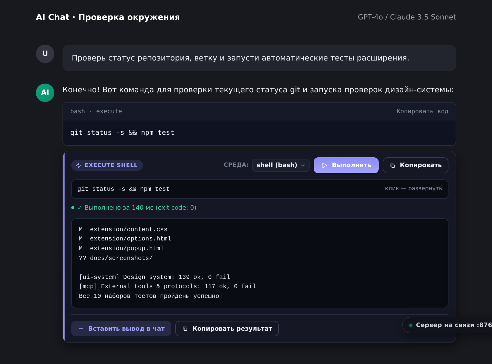
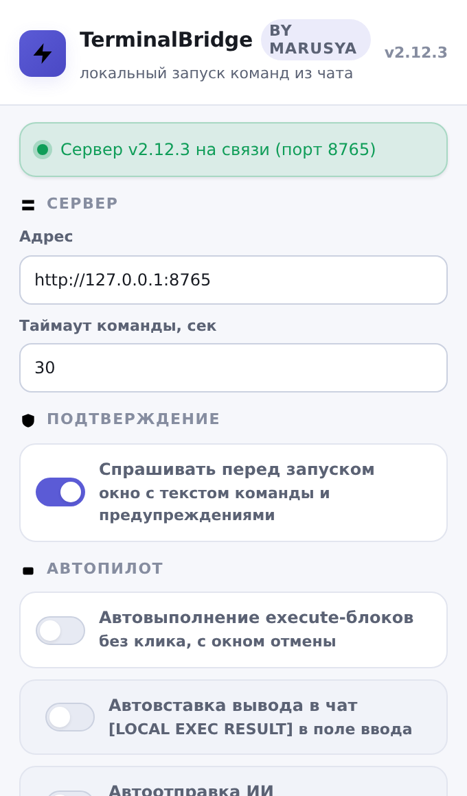
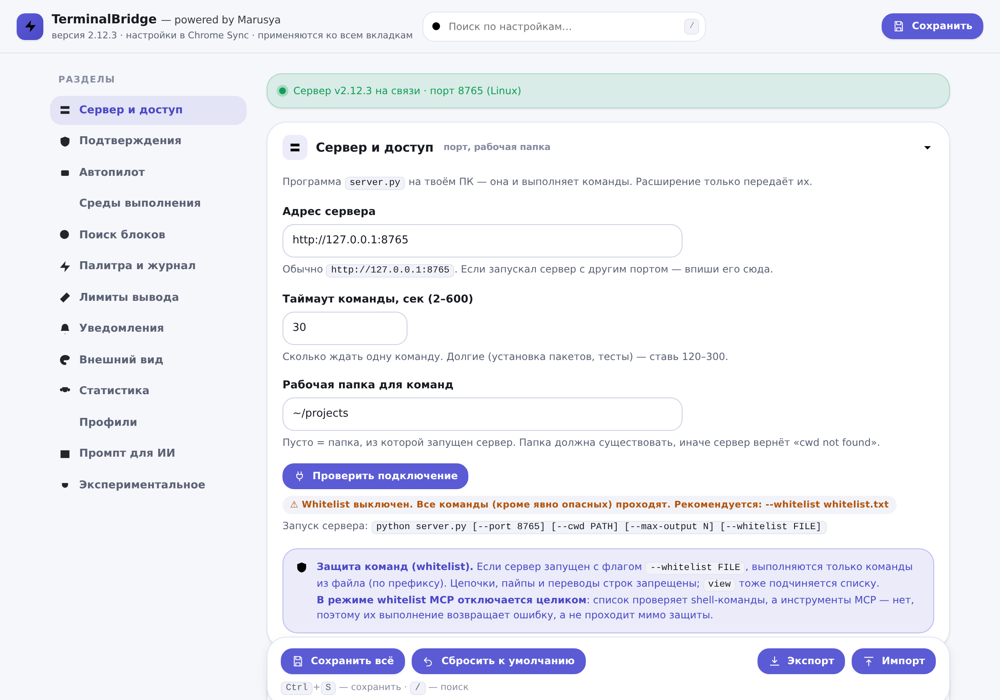
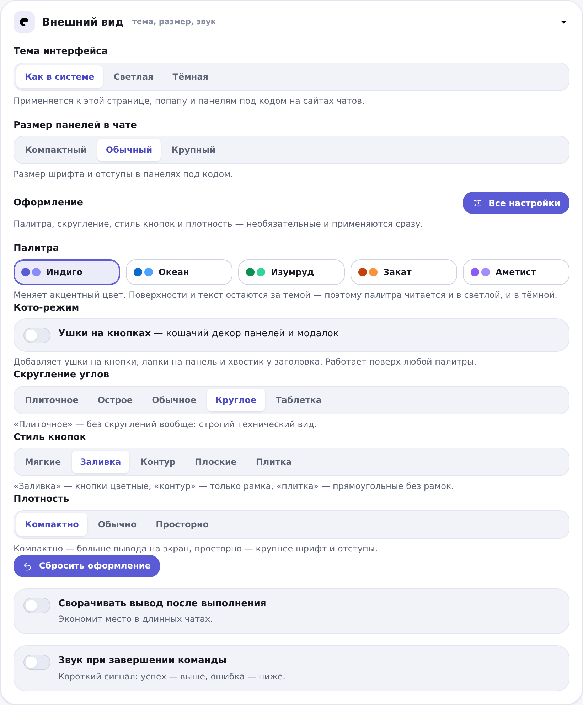

# ⚡ TerminalBridge — powered by Marusya

> **Безопасное выполнение команд и скриптов из веб-чатов с ИИ на вашем ПК**

**TerminalBridge** превращает обычные браузерные чаты (**ChatGPT**, **Claude**, **DeepSeek**, **Arena / LMSYS**, **Gemini**, **Grok**, **GigaChat**, **Perplexity** и др.) в полноценную среду разработки уровня Claude Code / Cursor:

1. ИИ пишет команду в блоке ```` ```execute ````
2. Под блоком появляется панель с кнопкой **▶ Выполнить**
3. Вы подтверждаете (или работает **Автопилот**) → команда выполняется локально на ПК
4. Результат выполнения возвращается обратно в чат для продолжения диалога

```
┌─ Браузерный ИИ ────────┐     ┌─ Расширение ───────────┐     ┌─ Ваш компьютер ──────┐
│ ```execute              │ ──▶ │ Кнопка ▶ или автопилот │ ──▶ │ server.py (127.0.0.1)│
│ git status              │     │ Предпросмотр + защита  │     │ bash · py · node · ps│
│ ```                     │ ◀── │ Вставка вывода в чат   │ ◀── │ Вывод: stdout/stderr │
└─────────────────────────┘     └────────────────────────┘     └──────────────────────┘
```

## 📸 Интерфейс расширения

| Выполнение команд прямо в чате | Быстрое меню (Popup) |
| :---: | :---: |
|  |  |

| Настройки и статус сервера | Тонкая настройка темы и оформления |
| :---: | :---: |
|  |  |

> 🔒 **Архитектура безопасности:** Браузерные расширения изолированы и не имеют прямого доступа к терминалу операционной системы. Поэтому используется локальный легковесный сервер `server.py`, который слушает исключительно `127.0.0.1`, защищён токеном авторизации и проверкой Host/Origin от атак из веба.

---

## 🚀 Быстрый старт за 2 минуты

### Шаг 1. Запустите локальный сервер

Требуется **Python 3.8+** (без сторонних зависимостей — только стандартная библиотека):

```bash
cd server
python server.py
# В Windows: py server.py
```

В консоли появится:
```text
============================================================
  TerminalBridge — powered by Marusya v2.12.3 — локальный сервер запущен
  http://127.0.0.1:8765  (только этот ПК)
============================================================
```

> 💡 **Авто-настройка токена:** Сервер генерирует и сохраняет защитный токен в `~/.ai-execute-runner.token`. Расширение автоматически забирает его по защищённому локальному каналу — настраивать токен вручную не требуется.

### Шаг 2. Установите расширение в браузер

Готовые архивы всегда доступны в [Releases](https://github.com/vvdd7232-lang/terminal-bridge/releases):

- **Google Chrome / Яндекс Браузер / Microsoft Edge:**
  1. Откройте `chrome://extensions` и включите **«Режим разработчика»** в правом верхнем углу.
  2. Распакуйте `terminal-bridge-2.12.2-chrome.zip` и нажмите **«Загрузить распакованное расширение»**.
- **Mozilla Firefox:**
  1. Откройте `about:debugging#/runtime/this-firefox`.
  2. Нажмите **«Загрузить временное дополнение…»** и выберите `terminal-bridge-2.12.2-firefox.xpi` (или `firefox-addon.xpi` в корне).

### Шаг 3. Скопируйте системный промпт для ИИ

1. Нажмите на иконку расширения в панели браузера → статус покажет **✅ Сервер на связи**.
2. Нажмите **«📋 Скопировать промпт для ИИ»** (или скопируйте текст из файла [`SYSTEM_PROMPT.md`](SYSTEM_PROMPT.md)).
3. Вставьте его первым сообщением в чат с ИИ и попросите:  
   *«Проверь, в какой папке мы находимся и покажи список файлов»*.

ИИ ответит execute-блоком → нажмите **▶ Выполнить**! 🎉

---

## 🧩 Поддерживаемые блоки и среды выполнения

Расширение распознаёт блоки с кодом и автоматически выбирает нужную среду:

| Блок кода | Среда | Что выполняет |
|---|---|---|
| ```` ```execute ```` или ```` ```exec ```` | **Shell** | `bash`/`sh` на Linux & macOS, `cmd.exe` на Windows |
| ```` ```execute-python ```` | **Python** | Исполнение скрипта через системный Python |
| ```` ```execute-js ```` | **Node.js** | Исполнение JavaScript через локальный `node` |
| ```` ```execute-pwsh ```` | **PowerShell** | Выполнение команд в PowerShell |
| ```` ```execute-mcp ```` | **MCP** | Запуск инструментов серверов Model Context Protocol |
| `view <путь_к_файлу>` | **Просмотр фото** | Загружает скриншот/изображение с ПК прямо в чат |

> 🛡️ Обычные блоки ```` ```bash ```` или ```` ```python ```` **не запускаются автоматически**, чтобы случайные примеры кода не выполнялись без вашего ведома.

---

## ✨ Ключевые возможности

### 🤖 Автопилот (Auto-Execution)
Режим автономной работы, при котором браузерный агент может последовательно писать код, выполнять его, анализировать вывод и исправлять ошибки:
- **Умное подтверждение:** Безопасные команды выполняются сразу, а деструктивные (`rm -rf /`, удаление дисков, sudo) блокируются до ручного подтверждения.
- **Loop Guard:** Защита от зацикливания ИИ — если модель повторяет одну и ту же команду несколько раз подряд, автопилот останавливается.
- **Ожидание стриминга:** Автопилот не перехватывает код до тех пор, пока ответ ИИ не завершён полностью.

### ⚡ Палитра команд (`Ctrl+Shift+E`)
Быстрый доступ к терминалу прямо из интерфейса чата (по аналогии с VS Code Command Palette):
- История последних 30 выполненных команд.
- Закрепление часто используемых сниппетов (`Ctrl+P`).
- Автоматическое скрытие секретов (токены, пароли маскируются как `[скрыто]`).

### 🖼️ Просмотр изображений (`view`)
Если ИИ сгенерировал график, диаграмму или скриншот, команда `view <файл>`:
1. Читает файл с диска и показывает превью в чате.
2. Автоматически прикрепляет изображение к полю ввода чата через Drag & Drop / File Input.
3. Поддерживает форматы: PNG, JPG, GIF, WebP, SVG, BMP (до 10 МБ).

### 🤖 Поддержка MCP (Model Context Protocol)
Позволяет веб-моделям управлять локальными приложениями (Blender, Godot, файловая система, базы данных):
- Поддерживает транспорт `stdio` и `Streamable HTTP`.
- Включается опционально через флаг `python server.py --mcp` и переключатель в настройках расширения.
- Готовый список доступных инструментов генерируется по кнопке «Скопировать список для ИИ» в настройках.

---

## ⚙️ Настройки и безопасность

Полная страница настроек доступна по клику на иконку шестерёнки ⚙️ в попапе или через контекстное меню расширения:
- **Белый список (Whitelist):** Запуск сервера командой `python server.py --whitelist whitelist.txt` разрешает только команды из списка (например, только чтение: `git status`, `ls`, `cat`).
- **Сворачивание шумного вывода:** Длинные листинги сборки (`npm install`, вывод компилятора) аккуратно сворачиваются, не засоряя чат.
- **Лимиты вывода:** Защита от переполнения памяти (настраиваемый лимит на размер stdout/stderr, по умолчанию 1 МБ).
- **Дизайн-система:** Выбор акцентных цветов, скруглений кнопок, тёмной и светлой темы.

---

## ❓ Частые вопросы и диагностика

| Проблема | Причина и решение |
|---|---|
| **Бейдж «offline»** | Убедитесь, что `python server.py` запущен в терминале. Проверьте адрес `http://127.0.0.1:8765/ping` в браузере. |
| **Кнопка ▶ не появляется** | ИИ написал обычный ` ```bash ` вместо ` ```execute `. Попросите ИИ переписать блок или включите «Нестрогий поиск» в настройках ⚙️. |
| **Ошибка 401 Unauthorized** | Расширение автоматически обновляет токен. Если этого не произошло, перезагрузите вкладку чата (`Ctrl+F5`). |
| **Вывод не вставился в чат** | На некоторых редких версиях интерфейсов поле ввода может быть заблокировано — кликните в поле ввода и нажмите `Ctrl+V` (текст уже скопирован в буфер). |
| **fatal: not a git repository** | Команда выполняется вне каталога проекта. Добавьте `cd <папка> && ...` или укажите рабочую папку в настройках сервера/расширения. |

---

## 🛠️ Разработка и тесты

```bash
# Запуск автоматических тестов
cd tests
npm install          # Установка jsdom для тестирования DOM-интерфейса
npm test             # Полный прогон всех 10 тестовых сьютов (сниффер, автопилот, модалки, UI)

# Запуск тестов Python сервера
python3 -m unittest discover tests
```

---

## 📄 Лицензия

Проект распространяется под свободной лицензией **MIT**. Подробности в файле [LICENSE](LICENSE).
Используйте с умом и проверяйте команды перед выполнением!
